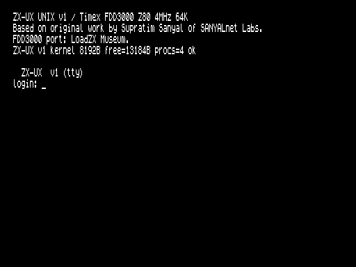
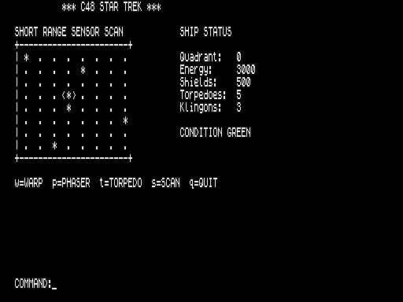

# ZX-UX on the Timex FDD3000

ZX-UX — *based on original work by Supratim Sanyal of SANYALnet Labs* — ported
from the 48K ZX Spectrum to the **Timex FDD3000**, the disk unit with its own
Z80, 64K of RAM and a WD1770. It runs the way TOS and the FDD3000's CP/M do:
on the disk unit's Z80, with a Timex computer (TT3000, TC3256 or TC2068
running the Terminal 3000 software) as a VT52 terminal on the link.

 

## What runs

- The ZX-UX kernel, shell and its 38 resident programs, unchanged in
  behaviour: four processes, the RAM file system, `vi`, `ps`, `top`, `tar`...
- **Disks**: `/dev/fd0` – `/dev/fd3` (drives A–D, 40/80 tracks, one or two
  sides, probed when opened); `/bin/dd` copies sectors.
- **ZXFS**, a disk file system mounted into the RAM tree (`/etc/mkfs`,
  `/etc/mount`, `/etc/umount`). It is built in; **other file system types
  are modules**, loaded from disk when a mount asks for them
  (`/etc/mount -t TYPE ...` loads `/mnt/a/etc/fs/TYPE`) and unloaded with
  their last mount — see *File system types* below.
- At boot `/etc/init` mounts the system disk on **`/mnt/a`** and runs
  `/mnt/a/etc/rc` from it (persistent: add `/etc/mount /dev/fd1 /mnt/b`
  there); `/mnt/a` – `/mnt/d` are the mount points for drives A–D.
- **SDK programs** (SSX1: C48, BASIC, Pascal, FORTRAN, Forth) run from any
  file with execute permission; the system disk's `/bin` (`/mnt/a/bin`, in
  the shell's path) carries ten
  C48 ones (`trek`, `advent`, `rogue`, `hangman`...). Programs that draw
  into the Spectrum's display file are shown on the terminal through a
  mirror that reads it back as text.

## Build and run

```sh
fdd3000/tools/fetch-sjasmplus.sh     # sjasmplus v1.21.0 into fdd3000/tools/bin
python3 fdd3000/tools/build.py       # spectrum gate + build/fdd3000/ZX-UX-FDD3000.dsk
```

`build.py spectrum` rebuilds the shipped Spectrum system from `zx-ux/src` and
checks it **byte for byte** against `zx-ux/tzx/ZX-UX.tzx` (upstream ships no
builder). Every FDD3000 change to the shared sources sits behind
`IFDEF FDD3000`; this gate proves the Spectrum system untouched.

In Fuse (the LoadZX fork, `TC3256/EMUL`): machine **TT3000**, the disk in
Timex FDD drive A (`--timex_fdddisk`); Machine › Timex FDD Reset if the
terminal came up first. On a real FDD3000: write the image to a disk, drive
A, reset.

Tests (Python, on the FDD3000-MSDOS project's FDD3000 model — Z80, WD177x,
boot ROM — with a model of the terminal's end of the link):

```sh
python3 fdd3000/test/test_fd.py      # the driver: three drives, sector-exact
python3 fdd3000/test/test_zfs.py     # ZXFS through the shell, checked on the host
python3 fdd3000/test/test_boot.py    # init's mount and rc, across reboots
python3 fdd3000/test/test_ssx.py     # SDK programs from disk, the mirror
python3 fdd3000/test/test_tmr.py     # the WD1770 clock: a program with no system calls
python3 fdd3000/test/test_bound.py   # the design book's boundary cases, on the disk side
python3 fdd3000/test/test_fsmod.py   # file system types loaded at mount time
python3 fdd3000/test/fuse_shot.py OUT.png 'root\r' 'trek\r' '~300'   # a Fuse screenshot
```

`tools/zxdfs.py` makes, fills, lists and checks ZXFS file systems in disk
images on the host (its docstring is the format's specification).

## How it is put together

| | |
|---|---|
| `src/boot.asm` | the boot sector: the FDD3000 boot ROM loads it to 3F00h; it loads the system from track 1 |
| `src/hal.asm` | the hardware layer: vectors, the console on the link (CBIOS A1.1's protocol) as a VT52, keys, the soft clock |
| `src/fd.asm` | the WD1770 driver, the buffer cache, `/dev/fd0-3` |
| `src/vfs.asm`, `src/fsmod.asm`, `src/zfs.asm` | mounts and the i-node cache; the type table and the module loader; ZXFS |
| `src/ssx.asm`, `src/t_dd.asm`, `src/t_fs.asm`, `src/t_mkfs.asm` | SSX1 from files; `dd`; `mount`, `umount`; `mkfs` |
| `src/mirror.asm` | the display file read back to the terminal |
| `src/tmr.asm` | the 50 Hz clock from the WD1770 (drive D's select line) |
| `tools/` | `build.py`, `fddimage.py` (the disk), `zxfs.py` (the RAM file system image), `zxdfs.py` (ZXFS), `fsmod.py` (file system modules), `dsk.py` |

Memory of the FDD3000 while ZX-UX runs:

| | |
|---|---|
| 0000h–0067h | restart vectors; RST 38h = the WD1770's INTRQ |
| 0068h–0FFFh | the Spectrum ROM's place: RST 30h traps (BEEP/BEEPER: RET) |
| 1000h–17FFh | the buffer cache (8 sectors) |
| 1800h–3EFFh | the hardware layer (and `dd`) |
| 3F00h–5AFFh | the boot sector, then the old display file: programs draw here |
| 5B00h–FFFFh | ZX-UX as on the Spectrum: kernel data, kernel at 6000h, arena, window at F000h |

### File system types

The mount layer (`vfs.asm`) knows mounts, not formats: a file system type
is a vector of nine operations (mount, load and store an i-node, read,
write, truncate, allocate and free an i-node, sync). The **type table**
(`fsmod.asm`, five entries: one per mount, plus ZXFS) names them.

- **ZXFS is built in** (type 1): the system disk is mounted with it before
  anything can be loaded.
- **Every other type is a module**, a file made by `tools/fsmod.py` from an
  assembly source whose first bytes are its vector. `mount -t NAME` uses
  the type NAME if it is in the table, else loads `/mnt/a/etc/fs/NAME`;
  `-t /path` loads that file; no `-t` tries the table's types in turn.
- **Where it lives.** The module is read into an arena block of its own
  kind (`K_FSM`) which compaction never moves, as with a loaded SSX1 image,
  and relocated there: `fsmod.py` assembles the source at 0000h and at
  0101h, and every word that differs by 0101h is listed as an address to
  adjust. When a type's last mount goes, its block goes back to the arena
  (`df` shows it). A mount that fails after loading its type unloads it too.
- **The kernel ABI.** A module calls the kernel by address: only the
  symbols in `fsmod.py`'s `ABI` list (the buffer cache, the transfer
  variables, the mount entry's fields, a few helpers), which the build
  writes to `build/fdd3000/kabi.inc`. Their checksum is in the module's
  header and in the kernel (`kabi`, set by a second build pass): a module
  built for another kernel is refused, not run.

`test/test_fsmod.py` builds ZXFS itself as two modules (`zxfsm`,
`zxfsn`) and mounts both at once. The first real module will be TOS's
format.

```sh
python3 fdd3000/tools/fsmod.py SOURCE.asm NAME OUT    # after build.py
```

### What the FDD3000 does not have, and what replaces it

- **A timer.** The only interrupt is the WD1770's INTRQ (the schematic:
  `/INT` from PAL IC9, whose one interrupt input is the FDC's IRQ; the WD2123
  is not wired to it; `/NMI` is only pulled up). So the WD1770 is made into
  one (`src/tmr.asm`): with drive **D** selected — the port assumes at most
  three drives, and checks at boot — a *Step* command (`2Ah`: no track
  update, no spin-up, no verify, 20 ms) raises INTRQ after 20 ms and the
  interrupt handler starts the next: a **50 Hz tick**, the Spectrum's. It
  runs the clock, accounts CPU, polls keys, refreshes the display mirror,
  preempts at the end of the time slice and delivers ^C — so a program that
  never makes a system call cannot starve the rest (`test/test_tmr.py`).
  The disk driver stops it around its own commands; the soft clock (each
  system call, character and idle turn adding its cost) counts meanwhile.
  **Drive D.** At boot the kernel restores drive D at 6 ms steps: a drive
  that is there shows TRACK 00 (an HFD305S drives it whenever selected),
  and then — a four-drive system — the soft clock keeps time and
  `/dev/fd3` is a disk. Only when D is absent does the clock take its
  select line.
  **The motors.** MOTOR ON is common to all drives (WD1770 MO → IC12
  74LS240 → PL1-16) and the WD1770 holds it up while the clock runs; but
  the HFD305S turns its motor only while it is selected — on a two-drive
  FDD3000, B never turns while A works — and while the clock runs no
  drive is selected (D is absent). So nothing turns. The driver ends a
  transfer with its drive still selected, light off, as CBIOS A1.1's
  `LIGHTOF` does, so MOTOR ON falls as the original firmware let it.
  *On a real FDD3000:* the drives must be jumpered DS0 – DS2, not **MX**
  ("constantly enabled regardless of DRIVE SELECT"): an MX drive would
  turn and step with the clock.
- **A ROM.** Programs that call the Spectrum ROM (the floating-point
  calculator, `RST 10h`) are stopped with a message; BEEP is silent.
- **Port FEh.** On the FDD3000 it is the drive latch: border colour or
  beeper writes would page the boot ROM in. `OUT (FEh),A` in a program is
  made harmless when it is loaded.
- **A display.** The terminal: 80 × 24, VT52. ZX-UX keeps its 64-column
  text; programs' pixels show as `#`, colours are not shown.

## Relation to the design

*The Design of the ZX-UX Operating System* (Supratim Sanyal; `docs/`, in Git
LFS) is the reference for the kernel. The port keeps the architecture it
describes and extends it at the hardware boundary; where it departs, it
says so here.

**Invariants kept** (its Appendix I):

| Invariant | In the port |
|---|---|
| Only SRUN slots run; each has a restorable context | the WD1770 tick switches from user mode as the frame ISR did; in the kernel it only sets `runrun` |
| One window owner; one SSX loan | unchanged |
| No allocation inside `swtch` | the tick, the idle loop, the mirror and the keys allocate nothing |
| Movable arena pointers repaired, reloaded | mounted i-nodes and the buffer cache live outside the arena; `ssxload` reads into the fixed IMAGE |
| A missing component leaves no usable parent | `vfscross` never writes `u_pdir` |
| Unlink + open references: freed at the last close | through the kernel's own `isopen` / `fclosea`; `itrunc` keeps HL for it |
| Open and resident files are not packed | nor are mounted ones (`zxpack` refuses them) |
| IY: the ROM's only while the caller's is saved | `sysent` unchanged; the VFS uses IY inside the kernel; the tick saves both banks (Appendix J) |
| The 8 KB kernel | 7,196 bytes |

**Where it departs, and why:**

- *"A RAM file system, not disk persistence"* (ch. 35). The RAM file system
  is still the root; disks are **mounted** into it (ZXFS, `vfs.asm`) through
  the kernel's own i-node interface, so the RAM file system's code is the
  same and its limits (24 i-nodes, the arena) still hold for RAM.
- **The 50 Hz heartbeat** (ch. 19, 23) comes from the WD1770 (`tmr.asm`),
  or, with a fourth drive, from the soft clock; preemption, BREAK and the
  clock behave as the book describes once the tick runs.
- **The console** (ch. 28) is the VT52 terminal; the display file stays
  RAM that programs draw into, read back by the mirror. The "two programs,
  one screen" console rows (ch. 2) are kept.
- **ROM is a service** (ch. 19) — there is none: ROM calls stop the program
  (BEEP is silent); `OUT (FEh)` and C48 `beep()`'s HALT are defused at load.
- **Seek** (ch. 27) keeps origins 0–2 and the 16-bit file limit; origins
  3–5 (in 256-byte sectors) are added for disks, as v6's 3–5 counted
  blocks, and are the only way past 64K on a device.
- **The boot chain** (ch. 20) gains one step: `init` mounts the system
  disk and runs its `rc` before the first `getty`; the shell (ch. 32) also
  looks in `/mnt/a/bin`.
- **Cassette** (ch. 6, 29): none; SSX1 programs are files, and `/etc/ldx`
  reads them from a descriptor instead of a tape.

**Checking** (ch. 34 distinguishes four kinds, each answering a different
question): the assembled-image size and symbol layout — `build.py` (the 8 KB
`ASSERT`, the HAL's bounds) and the byte-identical Spectrum gate; simulator
tests — `test/*.py` on the FDD3000 model, the port's analogue of `rvm`,
with `test_bound.py` taking the book's boundary cases to the disk side
(unlink while open, a full disk, long seeks and holes, paths across
mounts, BREAK during I/O, packed files, memory pressure); an emulator run
— Fuse (`fuse_shot.py`); and the real machine, still to come.

## Licence

ZX-UX is © 2026 Supratim Sanyal, SANYALnet Labs, under its own
**non-commercial** licence (`../LICENSE`), which requires the attribution
above in source and in the user interface (the boot banner carries it). Note
that the licence counts use "by or on behalf of" an organisation — a
nonprofit included — as commercial: publishing this port under an
organisation's name may need the author's written permission.
